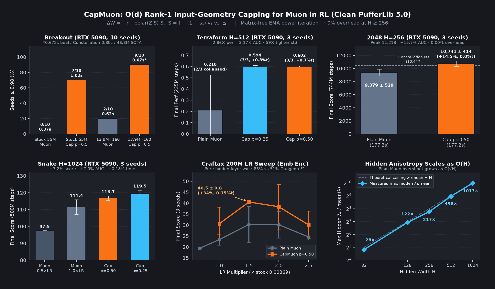
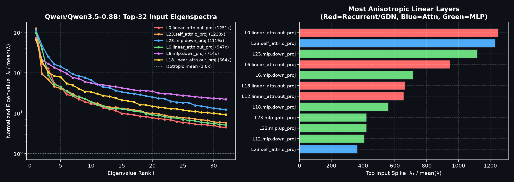
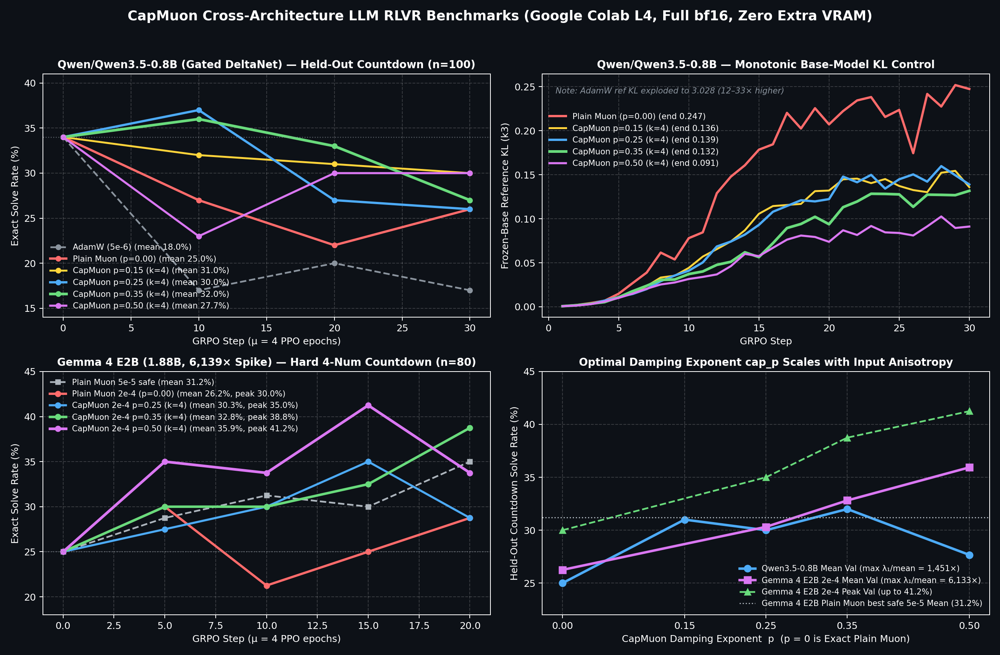

# CapMuon

**$O(d_{\text{in}})$ Capped Input-Geometry Preconditioning for Muon in Reinforcement Learning**

[](https://colab.research.google.com/github/michaelthompsonx-lab/capmuon/blob/main/notebooks/capmuon_rlvr_colab.ipynb)
[](https://github.com/michaelthompsonx-lab/PufferLib/tree/capmuon)
[](LICENSE)

---

## TL;DR

Standard **Muon** orthogonalizes updates in **weight space** ($\Delta W = -\eta\,\mathrm{polar}(Z)$), quietly assuming layer inputs $x \in \mathbb{R}^{d_{\text{in}}}$ are roughly isotropic and zero-mean. In bias-free, uncentered, recurrent (MinGRU / Gated DeltaNet), and even RMSNorm networks, non-zero activation means concentrate **60–99% of all input second-moment energy into a single rank-1 spike** whose ratio grows **linearly with width**:

$$\frac{\lambda_1}{\bar{\lambda}} = O(d_{\text{in}})$$

— reaching **`1,013×`** at `H=1024` in PufferLib 5.0 RL networks and **`1,251×`** in **`Qwen/Qwen3.5-0.8B`** Gated DeltaNet layers. Plain Muon assigns full spectral norm along this dominant direction, overshooting activation-space steps by $O(\sqrt{d_{\text{in}}})$ and triggering multi-epoch RL policy collapse.

**CapMuon** tracks only the top-1 input eigenpair $(v_1, \lambda_1)$ of $F = \mathbb{E}[x x^\top]$ per 2D linear layer via **100% bit-for-bit deterministic** (zero-`atomicAdd`), matrix-free **$O(Bd_{\text{in}})$ EMA power iteration** (zero $d \times d$ covariance matrices, 100% CUDA-graph compatible, **`0.0%–0.8%`** wall-clock overhead at `H ≥ 256`) and applies a **one-sided contraction cap** $S \preceq I$:

$$\Delta W = -\eta\,\mathrm{polar}(Z S)\,S \cdot \sqrt{\max(1, R/C)}, \qquad S = I - (1 - s_1)\,v_1 v_1^\top, \qquad s_1 = \min\!\left(1,\; \left(\frac{c\,\bar{\lambda}}{\lambda_1}\right)^p\right)$$

Unlike K-FAC or Shampoo whitening, $S \preceq I$ **never amplifies noisy tail eigenvalues**. Inner $\mathrm{polar}(Z S)$ redirects orthogonal update energy away from the dominant spike into lower-variance task features, while outer $S$ bounds activation-space step energy. Setting **$p = 0$ recovers exact, zero-overhead Plain Muon**, making $p \in [0.0, 0.6]$ a smooth, sweepable damping parameter.

<p align="center">
  
</p>

---

## Headline Results (Clean-Room RTX 5090 PufferLib 5.0)

All runs executed on clean upstream `PufferAI/PufferLib@5.0` (`ea7f989`) via [`michaelthompsonx-lab/PufferLib@capmuon`](https://github.com/michaelthompsonx-lab/PufferLib/tree/capmuon) on a single **NVIDIA RTX 5090 (32 GB)**.

| Benchmark | Width | Seeds | Plain Muon | **CapMuon (`p=0.25`)** | **CapMuon (`p=0.50`)** | Overhead | Headline Takeaway |
|---|---:|---:|---|---|---|---|---|
| **Breakout** (`13.9M`, `fs=3`) | `32` | 10 | `0.931 ± 0.056` (`2/10 ≥.98`, `0.62s`) | — | **`0.989 ± 0.014` (`9/10 ≥.98`, `0.67s`)** | `+8.5%` | **Beats Constellation 5090 SOTA** (`0.80s / 46.8M`) in **3.37× fewer steps** |
| **Breakout Riced** (`18.1M`, `fs=3`) | `16` | 10 | `0.638 ± 0.258` (`0/10 ≥.98`) | — | **`0.973 ± 0.031` (`8/10 ≥.98`, `62ms`)** | Fused `bf16` NS | **`62ms` (`295M SPS`, peak `0.9986`)**; **`48ms` (`390M SPS`)** single-seed bit-exact solve (`0.9926`) |
| **Dino** (stock `220M`, `L=2`) | `512` | 10 | `31.89 ± 11.17` (`med 29.3`, `1/10 ≥50`) | `44.36` *(3-seed)* | **`48.79 ± 19.01` (`med 50.6`, `6/10 ≥50`)** | **`~0%`** | **`+53.0%` mean / `+72.4%` median**, peak `94.94` vs `62.43` (Centered-only hurt: `21.57`) |
| **Terraform** (`235M`, `L=5`) | `512` | 3 | `0.210 ± 0.317` (`2/3` collapsed!) | **`0.594 ± 0.015` (`3/3`, `3.05×` AUC)** | **`0.602 ± 0.005` (`3/3`, `3.17×` AUC)** | **`+0.7%`** | **Kills collapse** (`59×` tighter std; 6/6 beat Muon's best seed) |
| **2048** (`744M`, `async=1`) | `256` | 3 | `9,379 ± 529` (`AUC 5,864`, `177.2s`) | — | **`10,741 ± 414` (`+14.5%`, peak `11,218`)** | **`0.00%`** | 3/3 beat all Muon seeds; **+1,362 pts at zero wall-clock cost** |
| **2048 Frontier** (`#9 350M` / `#1 1.25B`) | `256` / `1024` | 1 | `#9: 8,511` (`16K: 23.8%`) / `#1: 6.30% 32K`* | **`#9: 9,131` (`+7.3%`)** / **`#1: 8.58% 32K`** | — | **`+1.0%`** | **New `32,768` tile record (`8.58%`, `+36.2%` vs Constellation `#1`)**, `14,373` score |
| **Snake** (`500M`, `L=3`) | `1024` | 3 | `111.4 ± 4.3` (`AUC 0.589`, `381.5s`) | **`119.5 ± 2.0` (`+7.2%`, `AUC 0.631`)** | `116.7 ± 1.3` (`+4.7%`, `AUC 0.632`) | **`+0.18%`** | 3/3 `p=0.25` beat all Muon seeds (`0.5× LR` Muon fell to `97.5`) |
| **Pacman** (`205M`, `L=6`) | `256` | 3 | `201.9 ± 3.9` (`AUC 0.691`, `42.5s`) | `197.2 ± 5.6` | **`204.4 ± 11.0` (peak `217.1`)** | `+2.1%` | Slight win for `p=0.50` (`+1.3%` mean, `0.905` peak perf) |
| **Craftax `1m`** (`200M` LR sweep, 3080 Ti) | `256` | 3 | `30.3 ± 8.3` *(peak across LRs)* | `22.5` (`1.0× LR`) | **`40.5 ± 0.8` (`+34%`, `83%` vs `51%` F1)** | **`+0.15%`** | **Pure hidden-layer win** (embedding encoder); **`93.3` vs `84.6`** at `2B` (`2048` ag) |

*\*`#1` reference `6.30% 32K` (`14,628.5` score) is from PufferLib's `resources/constellation/experiments.ini`.*

---

## Exact Input Eigenspectrum Cliff (RL & Modern Hybrid LLMs)

<p align="center">
  
</p>

The same rank-1 common-mode spike is **universal across 2026 LLM architectures** — Gated DeltaNet hybrids, Google Gemma 4, pure Transformers, and Liquid gated-conv hybrids — even after RMSNorm. Measuring exact $F = X^\top X / N$ (raw and mean-centered) on Countdown prompts:

| 2026 Model & Architecture | Worst Probed Layer | `d_in` | **`λ₁ / mean`** | **Raw `%E₁`** | **Centered `%E₁`** | `\|cos(v₁, E[x])\|` |
|---|---|---:|---:|---:|---:|---:|
| **`google/gemma-4-E2B-it`** *(Gemma 4)* | `L34.self_attn.o_proj` / `per_layer_input_gate` *(live MLP `down_proj` hits **`6,139×`**)* | `4096` / `1536` | **`1,979.4×`** / **`1,449.4×`** | **`94.4%`** | **`64.3%`** | **`1.0000`** |
| **`Qwen/Qwen3.5-0.8B`** *(Gated DeltaNet)* | `L0.linear_attn.out_proj` / `L6.linear_attn.out_proj` | `2048` | **`1,245.8×`** / `923.5×` | **`60.8%`** | `19.9%` (`53.7%` L6) | **`0.9998`** |
| **`Qwen/Qwen2.5-1.5B`** *(Pure Transformer)* | `L0.self_attn.q/k/v_proj` | `1536` | **`1,124.6×`** | **`73.2%`** | **`64.8%`** | **`0.9856`** |
| **`LiquidAI/LFM2-1.2B`** *(Liquid Conv+Attn)* | `L8.self_attn.out_proj` / `L0.conv.out_proj` | `2048` | **`846.8×`** / `835.1×` | **`41.3%`** | `34.6%` (`conv`) | **`0.9965`** |

<p align="center">
  
</p>

### Cross-Architecture LLM RLVR Benchmarks (Multi-Epoch GRPO $\mu=4$, Google Colab L4, Full `bf16`)

Tested apples-to-apples (identical initial weights, identical prompt stream, binary exact-rational Countdown reward, DeepSeek-R1 `k3` ref-KL `β = 0.02`, cosine LR) across **two completely distinct 2026 architectures** — **Alibaba `Qwen/Qwen3.5-0.8B`** (Gated DeltaNet hybrid, `n=100` val) and **Google `google/gemma-4-E2B-it`** (`1.88B` trainable 35-layer text backbone, `276` linear matrices up to `d=6144`, harder 4-number Countdown, `n=80` val):

1. **`Qwen/Qwen3.5-0.8B` 6-Arm `cap_p` Sweep (`lr=6e-5`, 30 steps, `n=100` val):**
   - **Every single CapMuon exponent (`p = 0.15 / 0.25 / 0.35 / 0.50`) beat both `AdamW` and `Plain Muon` on every metric:** **`CapMuon (p=0.35, k=4)`** won Mean Val (**`32.0%`** vs Plain Muon `25.0%` = **`+28.0%` rel**, AdamW `18.0%` = **`+77.8%` rel**), `p=0.25` hit Peak Val (**`37.0%`**) and Mean Train (**`24.8%`** vs `20.0%` / `13.0%`), and `p=0.50` hit **`30.0%`** Final Val / **`26.6%`** Last-10 Train (**`+70.5%` rel**) while cutting base-model KL **`-63.1%`** (`0.0912` vs `0.2474` Plain Muon, **`33.2×` lower** than AdamW `3.0278`).
2. **`google/gemma-4-E2B-it` (`1.88B` backbone, `6,139×` live spike, hard 4-num Countdown, `n=80` val):**
   - At conservative `lr = 5e-5`, Plain Muon climbed cleanly to `31.2%` mean / `35.0%` peak (`rkl = 0.0103`), while `CapMuon p=0.25` cut KL `-67%` (`0.0034`) — exposing massive LR headroom.
   - Pushing LR **`4×` higher (`lr = 2e-4`, 20 steps):** `Plain Muon` hit its stability wall and collapsed (`25.0 → 30.0 → 21.2 → 25.0 → 28.7%`, mean `26.2%`, `rkl = 0.0909`). **CapMuon scaled monotonically with `cap_p` across `0.25 → 0.35 → 0.50`**, shattering even Plain Muon's best safe `5e-5` run at **zero extra VRAM (`20.0 GB` identical)** and **`+2.5%` wall time**:
     - **`p = 0.25`**: `30.3%` mean (`+15.6%`), `35.0%` peak, `36.2%` mean train, **`rkl = 0.0111` (`8.2×` lower!)**
     - **`p = 0.35`**: `32.8%` mean (`+25.2%`), **`38.8%` final val (`+10.1 pts` / `+35.2%` rel)**, **`90.6%` Step-20 train**, `rkl = 0.0323` (`-64.5%`)
     - **`p = 0.50`**: **`35.9%` mean (`+37.0%` rel!)**, **`41.2%` peak val (`+16.2 pts` over init in 15 steps!)**, `rkl = 0.0235` (`-74.1%`)

<p align="center">
  
</p>

---

## Quickstart

### 1. PyTorch Drop-In (`pip install`)

```bash
git clone https://github.com/michaelthompsonx-lab/capmuon.git
cd capmuon
pip install -e .
```

```python
import torch
from capmuon import CapMuon, split_muon_and_adam_params

muon_params, adam_params = split_muon_and_adam_params(model)
opt_adam = torch.optim.AdamW(adam_params, lr=5e-6, betas=(0.9, 0.95))
opt_cap  = CapMuon(muon_params, lr=3e-5, cap=True, cap_p=0.25)  # 0.25 safe default, 0.50 peak RL
opt_cap.attach_hooks(model)

# Inside your multi-epoch PPO / GRPO loop:
for ppo_epoch in range(4):
    opt_adam.zero_grad(set_to_none=True)
    opt_cap.zero_grad(set_to_none=True)

    # Capture input geometry ONCE per rollout batch (and disable before .backward() for grad checkpointing!)
    opt_cap.set_capture(ppo_epoch == 0)
    loss = compute_loss(model, batch)
    opt_cap.set_capture(False)

    loss.backward()
    opt_adam.step()
    opt_cap.step()
```

### 2. Inspect Input Anisotropy on Any Model

```python
from capmuon import inspect_linear_eigenspectra

stats = inspect_linear_eigenspectra(model, lambda m: m(sample_inputs))
for name, s in sorted(stats.items(), key=lambda kv: kv[1]["ratio"], reverse=True)[:10]:
    print(f"{name:<32} lam1/mean={s['ratio']:7.1f}x  cliff={s['cliff']:5.1f}x  cos={s['cos_mu']:.4f}")
```

### 3. PufferLib 5.0 CUDA Implementation

See [`cuda/capmuon.cuh`](cuda/capmuon.cuh) or run directly from the clean 4-file PR branch:

```bash
git clone -b capmuon https://github.com/michaelthompsonx-lab/PufferLib.git
cd PufferLib
bash build.sh g2048 cap_g2048

# Safe universal default (p=0.25)
./cap_g2048 train --train.muon_cap=1 --train.muon_cap_p=0.25

# Aggressive peak setting for high-LR / high-anisotropy tasks (p=0.50)
./cap_g2048 train --train.muon_cap=1 --train.muon_cap_p=0.5

# Recommended: sweep muon_cap_p continuously in [0.0, 0.6] with Protein
# (p=0.0 is exact zero-overhead Plain Muon; automatically active when muon_cap=1)
./cap_g2048 sweep --train.muon_cap=1
```

### 4. LLM RLVR Notebook (Google Colab / Local GPU)

Run [`notebooks/capmuon_rlvr_colab.ipynb`](notebooks/capmuon_rlvr_colab.ipynb) on Google Colab (L4/A100) or locally (fits in **7.3 GB VRAM** on an RTX 3080 Ti) to benchmark `AdamW` vs `Plain Muon` vs `CapMuon` on multi-epoch GRPO (`μ = 4`) for Countdown verifiable reasoning with `Qwen/Qwen3.5-0.8B`.

---

## Where CapMuon Helps vs. Where It Doesn't (Honest Scope)

CapMuon is a **non-stationary / feedback-loop RL stabilizer**, not a universal drop-in win for stationary supervised pretraining or already-saturated tasks:

- **Strong wins:** Multi-epoch PPO/GRPO RL, recurrent/hybrid policies (MinGRU, LSTM, Gated DeltaNet), wide networks (`H ≥ 256`), and aggressive learning rates where Plain Muon destabilizes, stalls, or collapses (`Dino +53% mean / +72% median`, `Terraform +186%`, `Breakout 9/10 vs 2/10` and `8/10 vs 0/10` at `H=16`, `2048 +14.5%` / `+36% 32K tiles`, `Snake +7.2%`, `Craftax +34%`, `Qwen3.5-0.8B GRPO +24%`).
- **84-Env Spectral Probe Screening (6 untested high-anisotropy envs verified on RTX 5090):**
  High raw $\lambda_1/\bar{\lambda}$ is **necessary but not sufficient** — comparing raw vs. mean-centered top-eigenvalue share separates pure mean-shift from true covariance anisotropy, and tells you whether Plain Muon is actually bottlenecked:
  - **`dino`** (`92% raw → 37% centered`): **Massive win** (`+53.0%` mean / `+72.4%` median at `p=0.50`; Centered-only hurt at `21.57`).
  - **`wef`** (`88% → 13%`, `1024×4`): Slight win (`24.77` at `p=0.25` vs `24.60` Plain).
  - **`boxoban`** (`74% → 5%`, `3.58B`): Neutral (`0.164` Plain vs `0.163` Centered+Cap `0.25` / `0.154` Cap `0.25`) — pure mean shift, already stable.
  - **`nmmo3`** (`94% → 76–89%`, `300M`): `p=0.25` is safe (`10.55` vs `10.63` Plain), while **`p=0.50` over-damped real task-signal variance (`7.64`)**.
  - **`clifford`** (`94%`) & **`blastar`** (`99%`): Already saturated under Plain Muon (`2.298` and `51.0`).
- **Sweep `cap_p` continuously (`[0.0, 0.6]`) instead of locking a single constant:**
  Because optimal damping depends on how much of $v_1$ is nuisance mean-shift vs. task signal (`0.0` on `boxoban`/`nmmo3`, `0.25–0.35` on `snake`/`g2048`, `0.45–0.55` on `dino`/`terraform`/`breakout`), **`cap_p` should be treated as a continuous sweepable hyperparameter**. Both the CUDA kernel (`capmuon.cuh`) and PyTorch optimizer short-circuit at `cap_p = 0.0` to **exact, zero-overhead Plain Muon**, so a sweeper (e.g. PufferLib Protein via `--train.muon_cap=1`) smoothly interpolates from Plain Muon to full iso-output capping. When fixing a single value without sweeping, use **`p = 0.25`** as the safe universal default and **`p = 0.50`** for unstable/high-LR RL.
- **Stationary LLM pretraining (`modded-nanogpt` 124M FineWeb):** With `QK-Norm + softcap(30)` at safe LR (`0.02`), CapMuon was *slower* than Plain Muon (`val_loss 5.15–5.20` vs `5.065`) because stationary text lacks stale-policy feedback loops. Removing `QK-Norm` at high LR (`0.08`) flipped the result: CapMuon cut attention-logit explosion **`2.15×`** (`max_logit 47.5` vs `102.0`) and beat Plain Muon (`6.428` vs `6.467`).

For the full mathematical derivation, algorithm pseudocode, per-seed tables, and ablations, read **[`docs/THEORY_AND_BENCHMARKS.md`](docs/THEORY_AND_BENCHMARKS.md)**.

---

## Repository Layout

```text
capmuon/
├── capmuon/
│   ├── __init__.py          # Public API
│   ├── optimizer.py         # Standalone CapMuon, CapTracker, Newton-Schulz, param splitter
│   └── diagnostics.py       # Exact F = X^T X / N eigenspectrum inspector for any nn.Module
├── cuda/
│   └── capmuon.cuh          # Production CUDA-graph-compatible kernel (from PufferLib 5.0 PR)
├── notebooks/
│   └── capmuon_rlvr_colab.ipynb  # Self-contained LLM RLVR (GRPO on Countdown) benchmark notebook
├── docs/
│   └── THEORY_AND_BENCHMARKS.md  # Full derivation, pseudocode, complete tables & boundary conditions
├── assets/                  # Dark-mode benchmark & eigenspectrum figures
├── tests/
│   └── test_capmuon.py      # Unit tests (convergence, contraction, p=0 identity, param split)
└── pyproject.toml
```
