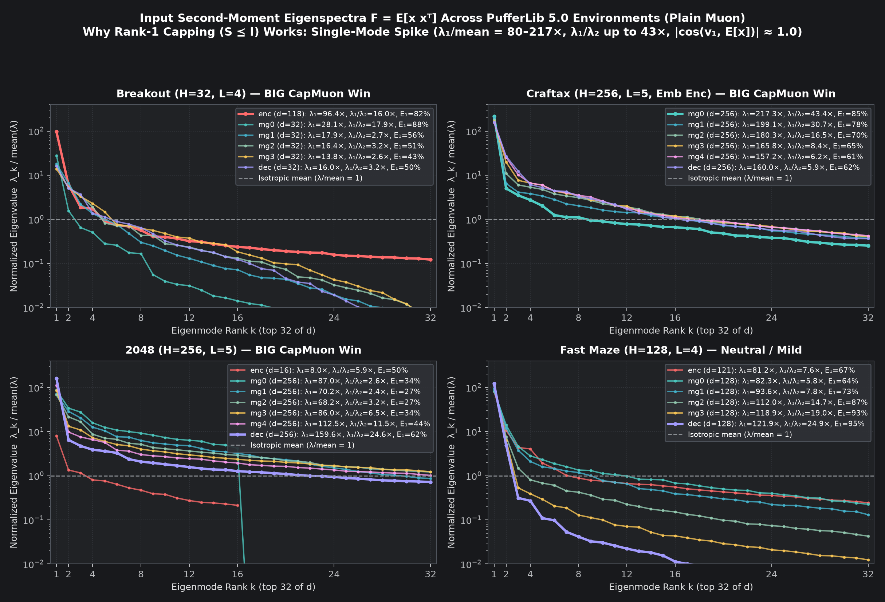

# CapMuon

**$O(d_{\text{in}})$ Capped Input-Geometry Preconditioning for Muon in Reinforcement Learning**

[](https://colab.research.google.com/github/michaelthompsonx-lab/capmuon/blob/main/notebooks/capmuon_rlvr_colab.ipynb)
[](https://github.com/michaelthompsonx-lab/PufferLib/tree/capmuon)
[](LICENSE)

---

## TL;DR

Standard **Muon** orthogonalizes updates in **weight space** ($\Delta W = -\eta\,\mathrm{polar}(Z)$), quietly assuming layer inputs $x \in \mathbb{R}^{d_{\text{in}}}$ are roughly isotropic and zero-mean. In bias-free, uncentered, recurrent (MinGRU / Gated DeltaNet), and even RMSNorm networks, non-zero activation means concentrate **60–99% of all input second-moment energy into a single rank-1 spike** whose ratio grows **linearly with width**:

$$\frac{\lambda_1}{\bar{\lambda}} = O(d_{\text{in}})$$

— reaching **`1,013×`** at `H=1024` in PufferLib 5.0 RL networks and **`1,251×`** in **`Qwen/Qwen3.5-0.8B`** Gated DeltaNet layers. Plain Muon assigns full spectral norm along this dominant direction, overshooting activation-space steps by $O(\sqrt{d_{\text{in}}})$ and triggering multi-epoch RL policy collapse.

**CapMuon** tracks only the top-1 input eigenpair $(v_1, \lambda_1)$ of $F = \mathbb{E}[x x^\top]$ per 2D linear layer via deterministic, matrix-free **$O(Bd_{\text{in}})$ EMA power iteration** (zero $d \times d$ covariance matrices, 100% CUDA-graph compatible, **`0.0%–0.8%`** wall-clock overhead at `H ≥ 256`) and applies a **one-sided contraction cap** $S \preceq I$:

$$\Delta W = -\eta\,\mathrm{polar}(Z S)\,S \cdot \sqrt{\max(1, R/C)}, \qquad S = I - (1 - s_1)\,v_1 v_1^\top, \qquad s_1 = \min\!\left(1,\; \left(\frac{c\,\bar{\lambda}}{\lambda_1}\right)^p\right)$$

Unlike K-FAC or Shampoo whitening, $S \preceq I$ **never amplifies noisy tail eigenvalues**. Inner $\mathrm{polar}(Z S)$ redirects orthogonal update energy away from the dominant spike into lower-variance task features, while outer $S$ bounds activation-space step energy.

<p align="center">
  
</p>

---

## Headline Results (Clean-Room RTX 5090 PufferLib 5.0)

All runs executed on clean upstream `PufferAI/PufferLib@5.0` (`ea7f989`) via [`michaelthompsonx-lab/PufferLib@capmuon`](https://github.com/michaelthompsonx-lab/PufferLib/tree/capmuon) on a single **NVIDIA RTX 5090 (32 GB)**.

| Benchmark | Width | Seeds | Plain Muon | **CapMuon (`p=0.25`)** | **CapMuon (`p=0.50`)** | Overhead | Headline Takeaway |
|---|---:|---:|---|---|---|---|---|
| **Breakout** (`13.9M`, `fs=3`) | `32` | 10 | `0.931 ± 0.056` (`2/10 ≥.98`, `0.62s`) | — | **`0.989 ± 0.014` (`9/10 ≥.98`, `0.67s`)** | `+8.5%` | **Beats Constellation 5090 SOTA** (`0.80s / 46.8M`) in **3.37× fewer steps** |
| **Terraform** (`235M`) | `512` | 3 | `0.210 ± 0.317` (`2/3` collapsed!) | **`0.594 ± 0.015` (`3/3`, `3.05×` AUC)** | **`0.602 ± 0.005` (`3/3`, `3.17×` AUC)** | **`+0.7%`** | **Kills collapse** (`59×` tighter std; 6/6 beat Muon's best seed) |
| **2048** (`744M`, `async=1`) | `256` | 3 | `9,379 ± 529` (`AUC 5,864`, `177.2s`) | — | **`10,741 ± 414` (`+14.5%`, peak `11,218`)** | **`0.00%`** | 3/3 beat all Muon seeds; **+1,362 pts at zero wall-clock cost** |
| **Snake** (`500M`) | `1024` | 3 | `111.4 ± 4.3` (`AUC 0.589`, `381.5s`) | **`119.5 ± 2.0` (`+7.2%`, `AUC 0.631`)** | `116.7 ± 1.3` (`+4.7%`, `AUC 0.632`) | **`+0.18%`** | 3/3 `p=0.25` beat all Muon seeds (`0.5× LR` Muon fell to `97.5`) |
| **Pacman** (`205M`) | `256` | 3 | `201.9 ± 3.9` (`AUC 0.691`, `42.5s`) | `197.2 ± 5.6` | **`204.4 ± 11.0` (peak `217.1`)** | `+2.1%` | Slight win for `p=0.50` (`+1.3%` mean, `0.905` peak perf) |
| **Craftax `1m`** (`200M` LR sweep, 3080 Ti) | `256` | 3 | `30.3 ± 8.3` *(peak across LRs)* | `22.5` (`1.0× LR`) | **`40.5 ± 0.8` (`+34%`, `83%` vs `51%` F1)** | **`+0.15%`** | **Pure hidden-layer win** (embedding encoder); **`93.3` vs `84.6`** at `2B` (`2048` ag) |

---

## Exact Input Eigenspectrum Cliff (RL & Modern Hybrid LLMs)

<p align="center">
  
</p>

The same rank-1 common-mode spike appears in **modern 2026 hybrid recurrent LLMs** — even after RMSNorm. Measuring exact $F = X^\top X / N$ on **`Qwen/Qwen3.5-0.8B`** (18 Gated DeltaNet + 6 Attention layers) reveals **`1,119× – 1,251×`** spikes with **60%+ of layer input energy in one mode**:

| `Qwen/Qwen3.5-0.8B` Layer | Shape | $\lambda_1 / \bar{\lambda}$ | $\lambda_1 / \lambda_2$ | `%E₁` | $|\cos(v_1, \mathbb{E}[x])|$ |
|---|---|---:|---:|---:|---:|
| **`L0.linear_attn.out_proj`** *(Gated DeltaNet)* | `(*, 2048)` | **1,250.7×** | `7.6×` | **61.1%** | **0.9996** |
| **`L23.self_attn.o_proj`** | `(*, 2048)` | **1,230.4×** | `13.3×` | **60.1%** | **0.9998** |
| **`L23.mlp.down_proj`** | `(*, 3584)` | **1,118.6×** | `2.4×` | **31.2%** | **0.9852** |
| `L18.linear_attn.out_proj` *(Gated DeltaNet)* | `(*, 2048)` | **663.6×** | `3.5×` | `32.4%` | `0.9947` |
| `L23.mlp.gate_proj` *(post-RMSNorm)* | `(*, 1024)` | **422.4×** | `7.3×` | `41.2%` | `0.9971` |
| `L23.self_attn.q/k/v_proj` *(post-RMSNorm)* | `(*, 1024)` | **363.9×** | `6.1×` | `35.5%` | `0.9977` |
| `L0.linear_attn.in_proj_qkv` *(post-RMSNorm)* | `(*, 1024)` | **355.8×** | `4.6×` | `34.7%` | `0.9557` |

<p align="center">
  
</p>

---

## Quickstart

### 1. PyTorch Drop-In (`pip install`)

```bash
git clone https://github.com/michaelthompsonx-lab/capmuon.git
cd capmuon
pip install -e .
```

```python
import torch
from capmuon import CapMuon, split_muon_and_adam_params

muon_params, adam_params = split_muon_and_adam_params(model)
opt_adam = torch.optim.AdamW(adam_params, lr=5e-6, betas=(0.9, 0.95))
opt_cap  = CapMuon(muon_params, lr=3e-5, cap=True, cap_p=0.25)  # 0.25 safe default, 0.50 peak RL
opt_cap.attach_hooks(model)

# Inside your multi-epoch PPO / GRPO loop:
for ppo_epoch in range(4):
    opt_adam.zero_grad(set_to_none=True)
    opt_cap.zero_grad(set_to_none=True)

    # Capture input geometry ONCE per rollout batch (and disable before .backward() for grad checkpointing!)
    opt_cap.set_capture(ppo_epoch == 0)
    loss = compute_loss(model, batch)
    opt_cap.set_capture(False)

    loss.backward()
    opt_adam.step()
    opt_cap.step()
```

### 2. Inspect Input Anisotropy on Any Model

```python
from capmuon import inspect_linear_eigenspectra

stats = inspect_linear_eigenspectra(model, lambda m: m(sample_inputs))
for name, s in sorted(stats.items(), key=lambda kv: kv[1]["ratio"], reverse=True)[:10]:
    print(f"{name:<32} lam1/mean={s['ratio']:7.1f}x  cliff={s['cliff']:5.1f}x  cos={s['cos_mu']:.4f}")
```

### 3. PufferLib 5.0 CUDA Implementation

See [`cuda/capmuon.cuh`](cuda/capmuon.cuh) or run directly from the clean 4-file PR branch:

```bash
git clone -b capmuon https://github.com/michaelthompsonx-lab/PufferLib.git
cd PufferLib
bash build.sh g2048 cap_g2048

# Safe universal default (p=0.25)
./cap_g2048 train --train.muon_cap=1 --train.muon_cap_p=0.25

# Aggressive peak setting for high-LR / high-anisotropy tasks (p=0.50)
./cap_g2048 train --train.muon_cap=1 --train.muon_cap_p=0.5
```

### 4. LLM RLVR Notebook (Google Colab / Local GPU)

Run [`notebooks/capmuon_rlvr_colab.ipynb`](notebooks/capmuon_rlvr_colab.ipynb) on Google Colab (L4/A100) or locally (fits in **7.3 GB VRAM** on an RTX 3080 Ti) to benchmark `AdamW` vs `Plain Muon` vs `CapMuon` on multi-epoch GRPO (`μ = 4`) for Countdown verifiable reasoning with `Qwen/Qwen3.5-0.8B`.

---

## Where CapMuon Helps vs. Where It Doesn't (Honest Scope)

CapMuon is a **non-stationary / feedback-loop RL stabilizer**, not a universal drop-in win for stationary supervised pretraining:

- **Strong wins:** Multi-epoch PPO/GRPO RL, recurrent/hybrid policies (MinGRU, LSTM, Gated DeltaNet), wide networks (`H ≥ 256`), and aggressive learning rates where Plain Muon destabilizes or collapses.
- **When to use `p = 0.25` vs `p = 0.50`:**
  - **`p = 0.25`**: Safest universal drop-in default (zero collapses anywhere; best on `Snake H=1024`; clears `Craftax 4096-agent` F2 saddle where `p = 0.50` over-damped).
  - **`p = 0.50`**: Peak gains on high-LR / high-anisotropy tasks (`Breakout`, `2048`, `Terraform`, `Pacman`, `Craftax 200M`).
- **Stationary LLM pretraining (`modded-nanogpt` 124M FineWeb):** With `QK-Norm + softcap(30)` at safe LR (`0.02`), CapMuon was *slower* than Plain Muon (`val_loss 5.15–5.20` vs `5.065`) because stationary text lacks stale-policy feedback loops. Removing `QK-Norm` at high LR (`0.08`) flipped the result: CapMuon cut attention-logit explosion **`2.15×`** (`max_logit 47.5` vs `102.0`) and beat Plain Muon (`6.428` vs `6.467`).

For the full mathematical derivation, algorithm pseudocode, per-seed tables, and ablations, read **[`docs/THEORY_AND_BENCHMARKS.md`](docs/THEORY_AND_BENCHMARKS.md)**.

---

## Repository Layout

```text
capmuon/
├── capmuon/
│   ├── __init__.py          # Public API
│   ├── optimizer.py         # Standalone CapMuon, CapTracker, Newton-Schulz, param splitter
│   └── diagnostics.py       # Exact F = X^T X / N eigenspectrum inspector for any nn.Module
├── cuda/
│   └── capmuon.cuh          # Production CUDA-graph-compatible kernel (from PufferLib 5.0 PR)
├── notebooks/
│   └── capmuon_rlvr_colab.ipynb  # Self-contained LLM RLVR (GRPO on Countdown) benchmark notebook
├── docs/
│   └── THEORY_AND_BENCHMARKS.md  # Full derivation, pseudocode, complete tables & boundary conditions
├── assets/                  # Dark-mode benchmark & eigenspectrum figures
├── tests/
│   └── test_capmuon.py      # Unit tests (convergence, contraction, p=0 identity, param split)
└── pyproject.toml
```
