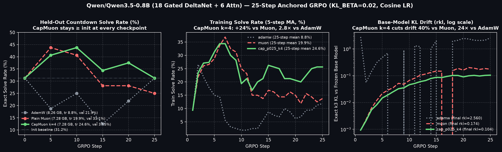
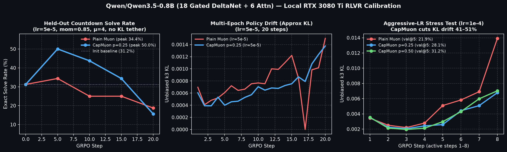
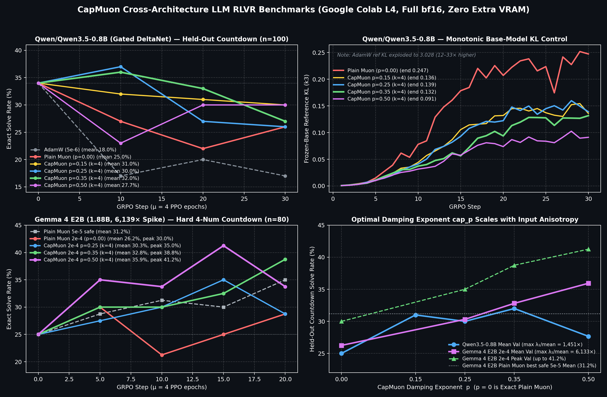

# CapMuon: Theory, Algorithm, and Complete Benchmark Analysis

This document provides the full mathematical derivation of CapMuon, the matrix-free $O(Bd)$ algorithm, complete clean-room RTX 5090 / RTX 3080 Ti RL results, stationary LLM pretraining ablations, and hybrid LLM (`Qwen/Qwen3.5-0.8B`) eigenspectrum measurements.

---

## 1. Why Plain Muon Overshoots in Reinforcement Learning

Consider a 2D linear layer $y = W x$ with $W \in \mathbb{R}^{R \times C}$ and inputs $x \in \mathbb{R}^C$ sampled from a batch $X \in \mathbb{R}^{B \times C}$. Let the empirical input second-moment matrix be:

$$F = \mathbb{E}[x x^\top] = \Sigma + \mu \mu^\top, \qquad \mu = \mathbb{E}[x], \qquad \bar{\lambda} = \frac{1}{C}\,\mathrm{tr}(F)$$

### 1.1 The $O(d)$ Common-Mode Anisotropy Scaling Law
In networks without explicit input centering (bias-free layers, uncentered observations, ReLU/SiLU/SwiGLU outputs, MinGRU/Gated DeltaNet recurrent states, and even post-RMSNorm activations where per-coordinate means $m_j = \mathbb{E}[x_j]$ are non-zero), the rank-1 mean outer product $\mu\mu^\top$ has eigenvalue $\|\mu\|_2^2 \approx C \cdot m^2$, whereas the mean eigenvalue is $\bar{\lambda} = \sigma^2 + m^2$. Consequently:

$$\frac{\lambda_1(F)}{\bar{\lambda}} \;\ge\; \frac{\|\mu\|_2^2}{\bar{\lambda}} \;\approx\; C \cdot \frac{m^2}{\sigma^2 + m^2} \;=\; \Theta(C)$$

As width $C$ grows from `32 → 1024 → 3584`, the top eigenvalue ratio grows **linearly** with layer width, concentrating **60%–99% of total input energy** into a single direction $v_1 \approx \mu / \|\mu\|_2$, separated from $\lambda_2$ by a $4\text{--}43\times$ spectral cliff.

### 1.2 Activation-Space Overshoot under Weight-Space Orthogonalization
Plain Muon computes $\Delta W_{\text{Muon}} = -\eta\,\mathrm{polar}(Z)$, so every right singular direction of $\Delta W$ has equal Euclidean norm $\eta$. Under a weight update $\Delta W$, the expected squared activation shift is:

$$\mathbb{E}\!\left[\|\Delta y\|_2^2\right] = \mathrm{tr}\!\left(\Delta W\, F\, \Delta W^\top\right) = \sum_{i=1}^{C} \lambda_i \,\|\Delta W v_i\|_2^2$$

Because $\Delta W_{\text{Muon}}$ allocates $\|\Delta W v_1\|_2^2 = \Theta(\eta^2)$ to the top mode $v_1$ where $\lambda_1 = \Theta(C \bar{\lambda})$, the activation-space step along $v_1$ is inflated by **$O(\sqrt{C})$** relative to isotropic task features. In multi-epoch PPO/GRPO RL, this creates a destructive feedback loop:
1. A coherent common-mode shift pushes pre-activations and policy logits off-manifold on PPO epoch 0.
2. Subsequent off-policy PPO epochs (`μ = 2..8`) compute gradients on stale rollouts under shifted hidden states, amplifying importance ratios, spiking KL / clipfrac, and collapsing policy entropy.

---

## 2. The CapMuon Update Rule

CapMuon defines a **one-sided contraction preconditioner** $S \preceq I$ acting only on the top-$k$ (default $k=1$) input eigenmodes $V = [v_1, \dots, v_k] \in \mathbb{R}^{C \times k}$:

$$S = I - \sum_{i=1}^{k} (1 - s_i)\, v_i v_i^\top, \qquad s_i = \min\!\left(1,\; \left(\frac{c\,\bar{\lambda}}{\lambda_i}\right)^p\right) \in (0, 1]$$

and computes the **symmetrically sandwiched polar update**:

$$\Delta W_{\text{CapMuon}} = -\eta\,\mathrm{polar}(Z S)\,S \cdot \sqrt{\max(1, R/C)}$$

### Why Each Piece Matters
1. **One-sided contraction ($S \preceq I$) vs. whitening (K-FAC / Shampoo):** Full inverse-square-root whitening $F^{-1/2}$ amplifies tiny noisy tail eigenvalues ($\lambda_C \ll \bar{\lambda}$), requiring fragile Tikhonov damping and $O(C^3)$ eigendecompositions. CapMuon leaves all directions with $\lambda_i \le c\bar{\lambda}$ **completely untouched** ($s_i = 1$) and strictly contracts only outlier spikes ($\lambda_i > c\bar{\lambda}$).
2. **Inner factor $Z S$ before $\mathrm{polar}(\cdot)$:** Simply applying outer $S$ after $\mathrm{polar}(Z)$ throws away update budget along $v_1$ without reallocating it. Scaling $Z \mapsto Z S$ *before* Newton-Schulz redirects the orthogonal polar factor's spectral energy out of the over-represented common mode and into lower-variance task features.
3. **Outer factor $\cdot S$ after $\mathrm{polar}(\cdot)$:** Guarantees that even if $\mathrm{polar}(Z S)$ still has non-zero projection onto $v_1$, the final activation-space step energy along $v_1$ is bounded by $s_1^2 \lambda_1 \propto \lambda_1^{1 - 2p}$:
   - At **`p = 0.50`**: $s_1^2 \lambda_1 = c\bar{\lambda}$ (exact activation-energy equalization for mode $v_1$).
   - At **`p = 0.25`**: $s_1^2 \lambda_1 = \sqrt{c\bar{\lambda}\,\lambda_1}$ (mild square-root compression — safer when $v_1$ still carries useful directional signal or under large batch sizes).
4. **Why CapMuon ≠ lowering learning rate:** On `Snake H=1024`, halving Plain Muon's LR (`0.5× LR`) *dropped* score from `111.4 → 97.5`, whereas CapMuon (`p=0.25`) at full `1.0× LR` *raised* score from `111.4 → 119.5` (`3/3` seeds beat Plain Muon). CapMuon preserves full step size in all $C - 1$ task directions while capping only the single rank-1 spike.

---

## 3. Matrix-Free $O(Bd)$ Streaming Power Iteration

Forming $F = X^\top X / B \in \mathbb{R}^{C \times C}$ is unnecessary for $k = 1$. Given a batch $X \in \mathbb{R}^{B \times C}$:

1. **Initialization ($t = 0$):** Set $v_1 \leftarrow \mu / \|\mu\|_2$ where $\mu = \frac{1}{B}\sum_{b=1}^B x_b$. Because $|\cos(v_1^*, \mu)| \approx 0.99\text{--}1.00$, initialization lands near the exact top eigenvector on Step 1.
2. **Streaming EMA power step ($t \ge 1$, decay $\gamma = 0.9$):**
   - $y = X v_1 \in \mathbb{R}^B$ — $O(BC)$
   - $\hat{\lambda}_1 = \frac{1}{B} \|y\|_2^2$, $\quad \widehat{\mathrm{tr}} = \frac{1}{B}\|X\|_F^2$ — $O(BC)$
   - $g_v = \frac{1}{B} X^\top y = \hat{F} v_1 \in \mathbb{R}^C$ — $O(BC)$
   - $\lambda_1 \leftarrow \gamma \lambda_1 + (1 - \gamma) \hat{\lambda}_1$, $\quad \mathrm{tr} \leftarrow \gamma\,\mathrm{tr} + (1 - \gamma)\,\widehat{\mathrm{tr}}$
   - $u = \gamma \lambda_1^{\text{prev}} v_1 + (1 - \gamma) g_v$, $\quad v_1 \leftarrow u / \|u\|_2$
3. **Update cadence:** Run **once per rollout batch** (`ppo_epoch == 0, minibatch == 0`), adding `0.0%–0.8%` wall-clock overhead at `H ≥ 256` and zero $d \times d$ memory. All operations are fixed-shape reductions, making the CUDA implementation (`cuda/capmuon.cuh`) 100% CUDA-graph compatible.

---

## 4. Exact Input Eigenspectrum Measurements

### 4.1 PufferLib 5.0 RL Networks ($B = 8192$)

| Environment & Layer | Width `d` | `λ₁ / mean` | `λ₂ / mean` | `λ₁ / λ₂` Cliff | `% Energy in λ₁` | `\|cos(v₁, E[x])\|` |
|---|---:|---:|---:|---:|---:|---:|
| Breakout `enc` | `118` | `96.4×` | `6.03×` | `16.0×` | `81.7%` | `0.996` |
| Breakout `mg0` | `32` | `28.1×` | `1.57×` | `17.9×` | `87.7%` | `0.995` |
| Maze `dec` | `128` | `121.9×` | `4.90×` | `24.9×` | `95.2%` | `1.000` |
| Craftax `mg0` | `256` | `217.3×` | `5.01×` | **`43.4×`** | `84.9%` | `1.000` |
| 2048 `dec` | `256` | `159.6×` | `6.48×` | `24.6×` | `62.4%` | `1.000` |
| Terraform `hid_max` | `512` | **`498.0×`** | — | — | `97.3%` | `~1.000` |
| Snake / Boxoban `hid_max` | `1024` | **`1,013.2×`** | — | — | `98.9%` | `~1.000` |

### 4.2 Modern Hybrid LLM: `Qwen/Qwen3.5-0.8B` (18 Gated DeltaNet + 6 Attention Layers)

Measured on Countdown reasoning prompts (`n=16`, non-pad tokens, exact `torch.linalg.eigh`):

| Layer | Shape | `λ₁ / mean` | `λ₁ / λ₂` | `%E₁` | `\|cos(v₁, E[x])\|` |
|---|---|---:|---:|---:|---:|
| `L0.linear_attn.out_proj` | `(*, 2048)` | **1,250.7×** | `7.6×` | **61.1%** | **0.9996** |
| `L23.self_attn.o_proj` | `(*, 2048)` | **1,230.4×** | `13.3×` | **60.1%** | **0.9998** |
| `L23.mlp.down_proj` | `(*, 3584)` | **1,118.6×** | `2.4×` | **31.2%** | **0.9852** |
| `L6.linear_attn.out_proj` | `(*, 2048)` | **946.7×** | `2.5×` | `46.2%` | `0.0920` |
| `L6.mlp.down_proj` | `(*, 3584)` | **714.2×** | `3.5×` | `19.9%` | `0.9826` |
| `L18.linear_attn.out_proj` | `(*, 2048)` | **663.6×** | `3.5×` | `32.4%` | `0.9947` |
| `L12.linear_attn.out_proj` | `(*, 2048)` | **656.3×** | `3.8×` | `32.0%` | `0.9967` |
| `L23.mlp.gate_proj` / `up_proj` *(post-RMSNorm)* | `(*, 1024)` | **422.4×** | `7.3×` | `41.2%` | `0.9971` |
| `L23.self_attn.q/k/v_proj` *(post-RMSNorm)* | `(*, 1024)` | **363.9×** | `6.1×` | `35.5%` | `0.9977` |
| `L0.linear_attn.in_proj_qkv` *(post-RMSNorm)* | `(*, 1024)` | **355.8×** | `4.6×` | `34.7%` | `0.9557` |

### 4.3 Universal 2026 Cross-Architecture Eigenspectrum Probe (Colab L4, Countdown Prompts)

| 2026 Model & Architecture | Worst Probed Layer (`d ≤ 4096`) | `d_in` | `λ₁ / mean` | Raw `%E₁` | Centered `%E₁` | `\|cos(v₁, E[x])\|` | Step-0 Countdown (`3–4` nums) |
|---|---|---:|---:|---:|---:|---:|---:|
| **`google/gemma-4-E2B-it`** *(Gemma 4)* | `L34.self_attn.o_proj` / `per_layer_input_gate` *(live `6144` MLP hits **`6,139×`**)* | `4096` / `1536` | **`1,979.4×`** / **`1,449.4×`** | **`94.4%`** | **`64.3%`** | **`1.0000`** | `62.5%` (`15/24`) |
| **`Qwen/Qwen3.5-0.8B`** *(Gated DeltaNet)* | `L0.linear_attn.out_proj` | `2048` | **`1,245.8×`** | **`60.8%`** | `19.9%` (`53.7%` L6) | **`0.9998`** | `37.5%` (`9/24`) |
| **`Qwen/Qwen2.5-1.5B`** *(Pure Transformer Base)* | `L0.self_attn.q/k/v_proj` | `1536` | **`1,124.6×`** | **`73.2%`** | **`64.8%`** | **`0.9856`** | `0.0%` *(Base)* |
| **`LiquidAI/LFM2-1.2B`** *(Liquid Conv+Attn)* | `L8.self_attn.out_proj` / `L0.conv.out_proj` | `2048` | **`846.8×`** / `835.1×` | **`41.3%`** | `34.6%` (`conv`) | **`0.9965`** | `4.2%` (`1/24`) |

---

## 5. Complete Clean-Room Benchmark Results

### 5.1 RTX 5090 Constellation Suite (`PufferAI/PufferLib@5.0`, commit `ea7f989`)

| Environment (Config / Width) | Seeds | Plain Muon | CapMuon `p=0.25` | CapMuon `p=0.50` | Wall Overhead | Notes |
|---|---:|---|---|---|---|---|
| **Breakout** (`cap50_r160`, `13.9M`, `H=32`, `fs=3`) | 10 | `0.9314 ± 0.0558` (`2/10 ≥.98`, `0.619s`) | — | **`0.9894 ± 0.0142` (`9/10 ≥.98`, `10/10 ≥.95`, `0.672s`)** | `+8.5%` | Beats Constellation 5090 SOTA (`0.80s / 46.8M → 0.9882`) in `3.37×` fewer steps |
| **Breakout** (stock `55M`, `H=32`, `fs=3`) | 10 | `0.9299 ± 0.0463` (`0/10 ≥.98`, `0.871s`) | — | **`0.9862 ± 0.0171` (`7/10 ≥.98`, `1.023s`)** | `+17%` | `0/10 → 7/10` solves (`≥0.98`) |
| **Breakout Riced** (`18.1M` / `18.5M`, `H=16, L=3`, `fs=3`) | 10 | `0.6379 ± 0.258` (`0/10 ≥.98`) | — | **`0.9732 ± 0.0313` (`8/10 ≥.98`, `62ms`)** | Fused `bf16` NS | `294.6M SPS` (`seed=9 → 0.9986`); `48ms` (`390M SPS`) single-seed bit-exact solve (`0.9926`) |
| **Dino** (stock `220M`, `H=512, L=2`) | 10 | `31.89 ± 11.17` (`med 29.32`, `1/10 ≥50`, `33.5s`) | `44.36` *(3-seed)* | **`48.79 ± 19.01` (`med 50.56`, `6/10 ≥50`, `32.9s`)** | **`~0%`** | **`+53.0%` mean / `+72.4%` median**, peak `94.94` vs `62.43` |
| **2048** (`744M`, `H=256, L=5`, `async=1`) | 3 | `9,378.6 ± 528.6` (`AUC 5,864`, `177.2s`) | — | **`10,740.5 ± 413.7` (`AUC 6,787`, peak `11,218`, `177.2s`)** | **`0.00%`** | `+14.5%` score (`+1,362` pts), `3/3` beat all Muon seeds |
| **2048 Frontier** (`#9 350M` / `#1 1.25B`, `h=512`) | 1 | `#9: 8,510.8` (`16K: 23.8%`) / `#1: 6.30% 32K` | **`#9: 9,131.0` (`+7.3%`)** / **`#1: 8.58% 32K`** | — | **`+1.0%`** | **New `32,768` tile record (`8.58%`, `+36.2%` vs Constellation `#1`)**, `14,373.4` score, `64.3%` `16K` |
| **Terraform** (`235M`, `H=512, L=5`) | 3 | `0.2101 ± 0.3165` (`2/3` collapsed, `AUC 0.138`, `128.0s`) | **`0.5938 ± 0.0150` (`3/3`, `AUC 0.423`, `129.1s`)** | **`0.6015 ± 0.0054` (`3/3`, `AUC 0.438`, `128.9s`)** | **`+0.7%`** | `2.86×` mean perf, `3.17×` AUC, `59×` tighter std |
| **Snake** (`500M`, `H=1024, L=3`) | 3 | `111.44 ± 4.33` (`AUC 0.589`, `381.5s`) | **`119.50 ± 1.99` (`AUC 0.631`, `382.2s`)** | `116.72 ± 1.34` (`AUC 0.632`, `382.4s`) | **`+0.18%`** | `+7.2%` score; `0.5× LR` Muon control dropped to `97.5` |
| **Pacman** (`205M`, `H=256, L=6`) | 3 | `201.85 ± 3.88` (`AUC 0.691`, `42.5s`) | `197.19 ± 5.64` | **`204.43 ± 10.96` (`AUC 0.701`, peak `217.1`, `43.4s`)** | `+2.1%` | Slight win for `p=0.50` |
| **Craftax `1m`** (`4096` ag, `2.0B`, `H=256, L=5`) | 2 | `84.34 / 74.91` (`AUC 0.230`, `594s`) | **`81.69` (`AUC 0.240`, `602s`)** | `58.53 / 61.92` *(stalled F2 at 4096 ag)* | `+1.2%` | `p=0.25` clears F2 saddle; see `2048`-ag & `200M` below |

### 5.1b 84-Env Spectral Probe Verification (6 Untested High-Anisotropy Envs, RTX 5090)

Probing 84 of 99 PufferLib envs for 30 s under Plain Muon identified the highest-anisotropy untested environments. Testing six spanning both pure mean-shift (`raw >> centered`) and true covariance anisotropy (`raw ≈ centered`) reveals when CapMuon wins vs. when `p` should stay low or zero:

| Env (`H×L`, steps) | Raw → Centered Share | Seeds | Plain Muon | Centered Only | CapMuon `p=0.25` | CapMuon `p=0.50` | Centered+Cap `0.25` | Diagnosis |
|---|---|---:|---|---|---|---|---|---|
| **`dino`** (`512×2`, `220M`) | `92% → 37%` | 10 *(3)* | `31.89 ± 11.17` *(27.51)* | *(21.57)* | *(44.36)* | **`48.79 ± 19.01`** | *(43.07)* | **Massive win** (`+53.0%` mean / `+72.4%` med, `6/10` vs `1/10 ≥50`); centering alone hurts |
| **`wef`** (`1024×4`, `75M`) | `88% → 13%` | 2 | `24.600` | `24.573` | **`24.770`** | `24.721` | `24.666` | Slight win (`+0.7%`); mostly mean-shift, low instability |
| **`boxoban`** (`512×2.5`, `3.58B`) | `74% → 5%` | 1 | **`0.1642`** | `0.1622` | `0.1535` | — | `0.1629` | Pure mean-shift (`5%` centered), already stable under Plain Muon |
| **`nmmo3`** (`512×6`, `300M`) | `94% → 76–89%` | 1 | **`10.625`** | `10.484` | `10.552` | `7.639` | — | High centered share = real task variance; `p=0.25` safe, `p=0.50` over-damps |
| **`clifford`** (`256×3`, `100M`) | `94% → 35%` | 3 | `2.298` | `2.298` | `2.298` | `2.298` | `2.299` | Already saturated under Plain Muon |
| **`blastar`** (`128×4`, `200M`) | `99% → 47–80%` | 3 | `50.996` (`3/3`) | `34.719` (`2/3`) | `34.020` (`2/3`) | `50.964` (`3/3`) | `50.951` (`3/3`) | Already saturated under Plain Muon (`51.0` ceiling) |

**Key lesson:** Raw anisotropy is a **prior, not a guarantee**, and optimal damping varies continuously by environment (`0.0` on `boxoban`/`nmmo3`, `0.25–0.35` on `snake`/`g2048`, `0.45–0.55` on `dino`/`terraform`/`breakout`). Treating `cap_p ∈ [0.0, 0.6]` as a **sweepable hyperparameter** (with `p = 0.0` short-circuiting to zero-cost exact Plain Muon) lets sweepers automatically select the right damping per task.

### 5.2 Additional RTX 3080 Ti Suites & Ablations
- **Craftax `1m` (`200M` LR sweep, `H=256`, 3 seeds):** CapMuon `p=0.50` hit **`40.5 ± 0.8`** (`83%` Floor-1 reach) vs Plain Muon's best LR **`30.3 ± 8.3`** (`51%` F1) — a **`+34%` pure hidden-layer win** (Craftax uses a category embedding encoder, so encoder capping is inactive). At `2.0B` with `2048` agents, `p=0.50` reached **`93.30`** vs Plain Muon **`84.57`** (`+10.3%`).
- **Maze (`H=128` fast `r53`, 5 seeds):** Neutral on final score (`0.995` vs `0.999`; `+4.5%` AUC on Muon configs). On wider `H=512` Stock Maze, CapMuon gained `+16%` AUC.

### 5.3 Stationary LLM Pretraining Ablation (`modded-nanogpt` 124M on FineWeb)
- Exact input eigenspectrum confirmed `266–424×` spikes even after RMSNorm (`L5.attn.c_q`, `L11.attn.c_proj`, `L11.mlp.c_proj`).
- **With `QK-Norm=1` + `softcap(30)` at safe LR (`0.02`):** Plain Muon `val_loss = 5.065` vs CapMuon `5.15–5.20` (CapMuon slower — stationary supervised text has no stale-policy feedback loop, and `v₁` carries early unigram signal).
- **Without `QK-Norm` at high LR (`0.08`):** CapMuon cut attention-logit explosion **`2.15×`** (`max_logit 47.5` vs `102.0`) and beat Plain Muon (`val_loss 6.428` vs `6.467`).

### 5.4 Preliminary LLM RLVR Results (`Qwen/Qwen3.5-0.8B`, RTX 3080 Ti)
Tested multi-epoch GRPO (`μ = 4`, 32 rollouts/step, binary verifiable Countdown reward, `temp = 0.6`, 186 hooked linear layers tracking `max_lam ≈ 1,445×` live at `+0.00 GB` VRAM):

- **25-step Anchored GRPO (`KL_BETA = 0.02` via zero-VRAM CPU-swap ref KL, cosine LR decay, `n=32` fixed val):**

| Arm | Peak VRAM | Mean Train Acc | Mean Val (`5–25`) | Val Trajectory (`0→5→10→15→20→25`) | Final Ref KL (`rkl`) | Mean Policy KL |
|---|---:|---:|---:|---|---:|---:|
| **`AdamW`** (`5e-6`) | `8.26 GB` | `8.8%` | `21.9%` | `31.2 → 18.8 → 25.0 → 12.5 → 21.9 → 31.2` | `2.5605` | `0.0041` |
| **`Plain Muon`** (`6e-5`) | `7.28 GB` | `19.9%` | `33.1%` | `31.2 → 43.8 → 40.6 → 28.1 → 28.1 → 25.0` | `0.1742` | `0.0005` |
| **`CapMuon k=4`** (`6e-5`) | **`7.28 GB`** | **`24.6%`** | **`37.5%`** | **`31.2 → 40.6 → 43.8 → 34.4 → 37.5 → 31.2`** | **`0.1045`** | **`0.0004`** |

  

- **20-step Unanchored Rank-$k$ Ablation (`lr_muon = 5e-5`, `momentum = 0.85`, `KL_BETA = 0`, `n=32` fixed val):**

| Arm | Init Val | Step 5 Val | Step 10 Val | **Step 15 Val** | Step 20 Val *(no KL tether)* | **Mean Train Acc** | **Mean KL** | Peak VRAM |
|---|---:|---:|---:|---:|---:|---:|---:|---:|
| Base `muon` | 31.2% | 34.4% | 25.0% | 25.0% | 18.8% | `19.4%` | `0.0008` | 7.28 GB |
| **`cap_p025 (k=1)`** | 31.2% | **50.0%** | **43.8%** | 34.4% | 15.6% | `21.2%` | `0.0007` | 7.28 GB |
| **`cap_p025 (k=4)`** | 31.2% | 37.5% | **43.8%** | **43.8%** *(Step 15 tr 56.2%)* | 15.6% | **`25.6%`** | **`0.0006`** | 7.28 GB |
| **`cap_p025 (k=8)`** | 31.2% | 43.8% | 40.6% | 37.5% | 18.8% | `23.6%` | **`0.0005`** | 7.29 GB |

- **Aggressive-LR stress test (`lr_muon = 1e-4`, `momentum = 0.95`):** By Step 5, Base Muon dropped `31.2% → 21.9%` (`kl = 0.0051`, `clip = 5.8%`), whereas `cap_p025` (`28.1%`, `kl = 0.0026`, `clip = 2.2%`) and `cap_p050` (`31.2%`, `kl = 0.0030`, `clip = 2.9%`) cut KL drift `41–51%` and clipfrac `50–62%`. Without a KL tether or LR decay, all three drifted off the pretrained manifold by Steps 8–10.
- **Conservative-LR check (`lr_muon = 3e-5`, `momentum = 0.95`, 10 steps):** Both arms climbed cleanly with `clip ≈ 0.0%`; Base Muon reached `46.9%` vs `cap_p050` `37.5%` (consistent with `p = 0.50` over-damping when LR is already well below Muon's stability limit; `p = 0.25` at `5e-5` reached **`50.0%`**).

  

### 5.5 Cross-Architecture LLM RLVR Benchmarks (Google Colab L4, Full `bf16`, Multi-Epoch GRPO $\mu=4$)

#### A. `Qwen/Qwen3.5-0.8B` 6-Arm Continuous `cap_p` Sweep (`lr=6e-5`, 30 steps, `n=100` held-out Countdown, `KL_BETA=0.02`, cosine LR)

| Arm (`k=4`, `186` matrices, `max_lam=1,451×`) | Init Val | **Mean Val (`10–30`)** | **Final Val** | **Peak Val** | **Mean Train** | **Last-10 Train** | **Final `rkl`** | Wall Time |
|---|---:|---:|---:|---:|---:|---:|---:|---:|
| **`AdamW`** (`5e-6`) | `34.0%` | `18.0%` | `17.0%` | `34.0%` | `13.0%` | `14.7%` | `3.0278` | `1,110s` |
| **`Plain Muon` (`p=0.00`)** | `34.0%` | `25.0%` | `26.0%` | `34.0%` | `20.0%` | `15.6%` | `0.2474` | `1,412s` |
| **`CapMuon` (`p=0.15`)** | `34.0%` | `31.0%` (`+24%`) | **`30.0%`** | `34.0%` | `23.2%` | `23.4%` | `0.1359` (`-45%`) | `1,296s` |
| **`CapMuon` (`p=0.25`)** | `34.0%` | `30.0%` (`+20%`) | `26.0%` | **`37.0%`** | **`24.8%`** | `24.7%` | `0.1389` (`-44%`) | `1,295s` |
| **`CapMuon` (`p=0.35`)** | `34.0%` | **`32.0%` (`+28%` rel)** | `27.0%` | `36.0%` | `23.3%` | `20.6%` | `0.1317` (`-47%`) | `1,321s` |
| **`CapMuon` (`p=0.50`)** | `34.0%` | `27.7%` (`+11%`) | **`30.0%`** | `34.0%` | `24.7%` | **`26.6%` (`+71%` rel)** | **`0.0912` (`-63%`)** | `1,324s` |

#### B. `google/gemma-4-E2B-it` (`1.88B` 35-layer text backbone, `276` matrices, `max_lam=6,139×`, hard 4-number Countdown, `n=80` val)

| Arm (`Gemma 4 E2B`, `KL_BETA=0.02`, cosine LR) | Val Trajectory (`0→5→10→15→20`) | **Mean Val (`5–20`)** | **Final Val** | **Peak Val** | **Mean Train** | **Final `rkl`** | Peak VRAM | Time |
|---|---|---:|---:|---:|---:|---:|---:|---:|
| `Plain Muon` (`5e-5` safe LR, 25 steps) | `25.0 → 28.7 → 31.2 → 30.0 → 35.0%` *(25: `33.8%`)* | `31.2%` | `35.0%` *(`33.8%`)* | `35.0%` | `35.0%` | `0.0103` | `20.0 GB` | `2,595s` |
| `CapMuon p=0.25` (`5e-5` safe LR, 25 steps) | `25.0 → 28.7 → 28.7 → 31.2 → 31.2%` *(25: `28.7%`)* | `30.0%` | `31.2%` *(`28.7%`)* | `31.2%` | `34.0%` | **`0.0034` (`-67%`)** | `20.0 GB` | `2,657s` |
| **`Plain Muon` (`2e-4`, `p=0.00`, 20 steps)** | `25.0 → 30.0 → 21.2 → 25.0 → 28.7%` | `26.2%` | `28.7%` | `30.0%` | `28.9%` | `0.0909` | `20.0 GB` | `2,082s` |
| **`CapMuon` (`2e-4`, `p=0.25, k=4`, 20 steps)** | `25.0 → 27.5 → 30.0 → 35.0 → 28.7%` | `30.3%` (`+16%`) | `28.7%` | `35.0%` | **`36.2%`** | **`0.0111` (`-88%`)** | **`20.0 GB`** | `2,198s` |
| **`CapMuon` (`2e-4`, `p=0.35, k=4`, 20 steps)** | **`25.0 → 30.0 → 30.0 → 32.5 → 38.8%`** | `32.8%` (`+25%`) | **`38.8%` (`+35%` rel)** | `38.8%` | `36.1%` | `0.0323` (`-65%`) | **`20.0 GB`** | `2,200s` |
| **`CapMuon` (`2e-4`, `p=0.50, k=4`, 20 steps)** | **`25.0 → 35.0 → 33.8 → 41.2 → 33.8%`** | **`35.9%` (`+37%` rel)** | `33.8%` | **`41.2%`** | `34.2%` | `0.0235` (`-74%`) | **`20.0 GB`** | `2,135s` |

  

**Key Takeaway:** Because Gemma 4's worst layer spike (`6,139×`) is `4.2×` larger than Qwen3.5-0.8B's (`1,451×`), Gemma 4 benefits from stronger damping (`p = 0.35–0.50` vs `p = 0.25–0.35` on Qwen3.5) — unlocking a **`4×` higher LR (`2e-4`)** that beats both matched-LR Plain Muon (`+37%` mean val) and Plain Muon's best conservative `5e-5` run (`41.2%` peak / `38.8%` final vs `35.0%` / `33.8%`), directly validating continuous sweepable `cap_p ∈ [0.0, 0.6]`.

---

## 6. Can Input Anisotropy Be Fixed Prior to the Optimizer? (Pre-Optimizer Ablation)

A natural question is whether fixing the upstream architecture (e.g., removing the `+0.5` bias in PufferLib 5.0's MinGRU candidate `h_tilde = (hidden >= 0) ? hidden + 0.5 : sigmoid(hidden)` by zero-centering it to `h_tilde - 0.5`) eliminates the need for CapMuon. We tested zero-centered MinGRU (`h_tilde(0) = 0`, exact $C^1$ derivative, zero overhead) directly against CapMuon on clean PufferLib 5.0 (RTX 3080 Ti):

| Benchmark | Plain Muon (stock) | **Centered MinGRU (Muon)** | **CapMuon `p=0.50` (stock)** | **Centered + CapMuon `p=0.50`** |
|---|---|---|---|---|
| **Breakout** (stock `55M`, `H=32`, 10 seeds) | `0.9496 ± 0.0656` (`4/10 ≥.98`) | `0.9146 ± 0.1031` (`3/10 ≥.98`) | **`0.9927 ± 0.0087` (`9/10 ≥.98`)** | **`0.9945 ± 0.0058` (`10/10 ≥.98`, min `0.980`)** |
| **Terraform** (`235M`, `H=512`, 3 seeds) | `0.2223 ± 0.3392` (`2/3` collapsed: `0.026, 0.027, 0.614`) | `0.4133 ± 0.3346` (`1/3` still collapsed: `0.027, 0.606, 0.607`) | **`0.5973 ± 0.0061` (`3/3`: `0.604, 0.592, 0.596`)** | **`0.6057 ± 0.0021` (`3/3`: `0.605, 0.608, 0.604`)** |

**Takeaway:**
1. **Upstream centering alone is NOT sufficient:** Even when MinGRU is zero-centered at initialization, uncentered encoders (`Breakout`), learned activation asymmetry during RL training (`Terraform` seed 73 still collapsed to `0.027`), and non-mean variance spikes (`Qwen3.5-0.8B` `L6.linear_attn.out_proj`: `947×` with `|cos(v₁, E[x])| = 0.092`) still break Plain Muon.
2. **Architectural hygiene and CapMuon are complementary:** CapMuon alone solves `9/10` Breakout and `3/3` Terraform without altering the forward pass (critical for pretrained LLMs), and combining `Centered MinGRU + CapMuon` achieved **`10/10 ≥ 0.98`** on Breakout and **`0.6057 ± 0.0021`** (`161×` tighter std than Plain Muon) on Terraform.

---

## 7. Hyperparameter Guide & Future Expansions

| Parameter | Default | Guidance |
|---|---:|---|
| `cap_p` | `0.25` (sweep `[0.0, 0.6]`) | **Recommended:** sweep continuously over `[0.0, 0.6]` (`0.0` short-circuits to exact zero-overhead Plain Muon; active automatically in PufferLib sweeps with `--train.muon_cap=1`). For fixed runs, use **`0.25`** as the safe universal default (`snake`, `g2048`, `nmmo3`, `Qwen3.5`) and **`0.50`** for unstable / high-LR RL (`dino`, `terraform`, `breakout`, `craftax`). |
| `cap_c` | `1.0` | Threshold multiplier $c$ in $s_i = \min(1, (c\bar{\lambda}/\lambda_i)^p)$. Leave at `1.0`. |
| `cap_ema` | `0.9` | EMA decay for streaming power iteration. Works well across `0.85–0.95`. |
| `cap_rank` | `1` | `k = 1` captures the exact $O(d)$ common-mode cliff at minimal cost. |
| Capture cadence | Once per rollout batch | Call `set_capture(True)` on `ppo_epoch == 0, mb == 0` and `set_capture(False)` before `.backward()`. |
